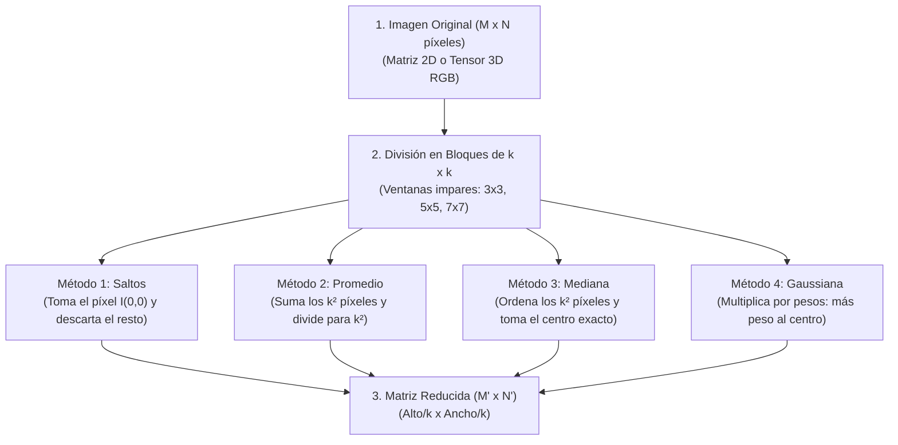
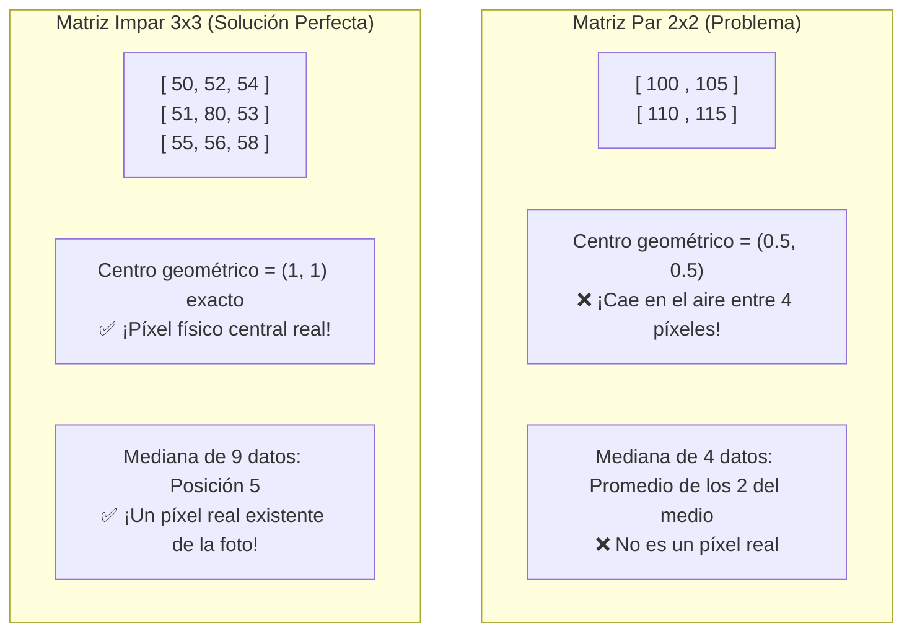

# 🖼️ Guía Visual y Didáctica de Fórmulas y Código: Reducción de Imagen
## Proyecto: Reducción Matricial sin Funciones de Librería (Inteligencia Artificial - UTA)

Esta guía explica **en cristiano, de forma visual y paso a paso** cada una de las fórmulas del informe, los algoritmos implementados en `codigo/main.py` y `app.py`, y la justificación matemática de por qué operamos exclusivamente con **matrices impares ($3\times3, 5\times5, 7\times7$)** sin recurrir a cajas negras como `cv2.resize` o `imresize`.

---

## 🧭 Diccionario Rápido: De Símbolos Raros a tu Código Real

| Símbolo en Libros / Informe | ¿Qué significa en la vida real? | Variable en tu código (`main.py` / `app.py`) |
| :---: | :--- | :--- |
| **$M \times N$** | Dimensiones originales (Alto $\times$ Ancho en píxeles) | `alto_orig`, `ancho_orig` |
| **$k$** | Factor de salto o tamaño del bloque impar ($3, 5, 7$) | `paso_k` o `paso` |
| **$M' \times N'$** | Nuevas dimensiones tras reducir | `alto_nuevo`, `ancho_nuevo` |
| **$k^2$** | Total de píxeles por bloque ($3^2 = 9$, $5^2 = 25$, $7^2 = 49$) | `total_pixeles_bloque` |
| **$I(i, j)$** | Píxel individual con valor de brillo entre $0$ (negro) y $255$ (blanco) | `imagen[fila, columna]` |
| **$I(i\cdot k, j\cdot k)$** | Píxel muestreado por saltos en filas y columnas | `imagen_original[fila * paso_k, columna * paso_k]` |
| **$\frac{1}{k^2}\sum I$** | Promedio de luminosidad de los $k^2$ píxeles vecinos | `promedio` |
| **$\text{mediana}(B)$** | Píxel central exacto de la lista ordenada de $k^2$ píxeles | `mediana_valor` |
| **$K(u, v)$** | Matriz gaussiana de pesos normalizada ($\sum K = 1.0$) | `kernel_normalizado` |
| **Ahorro (\%)** | Porcentaje de memoria y píxeles liberados $(1 - M'N'/MN)\times 100$ | `porcentaje_ahorro` o `savings_pct` |

---

## 🗺️ Mapa de Flujo: ¿Cómo se reduce una imagen matriz a matriz?

---

## 1. ¿Por qué el profesor prohibió `imresize` y `cv2.resize`?

Porque funciones como `cv2.resize(img, (w, h))` son **cajas negras automáticas**:
1. Ocultan la manipulación de índices (`[i*k, j*k]`).
2. Aplican por defecto **interpolación bilineal o bicúbica**, inventando valores decimales aproximados mediante polinomios.
3. El profesor quiere evaluar si entiendes **cómo se almacena una imagen en la memoria RAM** (una matriz bidimensional de números entre 0 y 255) y cómo se realiza el **muestreo espacial directo**.

---

## 2. ¿Por qué usamos obligatoriamente Matrices Impares ($3\times3, 5\times5, 7\times7$)?

Esta es la **pregunta estrella del examen**:

1. **Centro Geométrico Simétrico Entero:**
   $$\text{Centro} = \left(\frac{k-1}{2}, \frac{k-1}{2}\right)$$
   * Para $k = 3$: Centro en $(1, 1)$.
   * Para $k = 5$: Centro en $(2, 2)$.
   * Para $k = 7$: Centro en $(3, 3)$.
2. **Mediana Pura sin Inventar Píxeles:**
   Al ser $k$ impar, $k^2$ es siempre impar ($3^2 = 9$, $5^2 = 25$, $7^2 = 49$). Por tanto, la posición central $\frac{k^2+1}{2}$ existe físicamente en el arreglo.
3. **Campana Gaussiana Balanceada:**
   Permite colocar el pico máximo de la campana de Gauss en el centro exacto $(0, 0)$ y distribuir los pesos simétricamente a los cuatro lados.

---

## 3. Ejemplo Numérico Real Paso a Paso (Bloque $3\times3$)

Supongamos que en la esquina superior izquierda de la imagen tenemos esta matriz de 9 píxeles:

$$\begin{bmatrix}
58 & 59 & 59 \\
56 & 55 & 54 \\
41 & 42 & 44
\end{bmatrix}$$

### Método 1: Submuestreo por Saltos (Decimación)
* **Lógica:** Toma directamente la esquina $(0, 0)$ y descarta los otros 8 píxeles.
* **Cálculo:**
  $$\text{Píxel Resultante} = 58$$
* **Pros y Contras:** Ultrarrápido, pero si saltas sobre un borde fino puede aparecer "aliasing" (bordes dentados).

### Método 2: Promedio de Bloques (Mean Pooling)
* **Lógica:** Aprovecha la redundancia de los vecinos sumándolos y sacando la media.
* **Cálculo:**
  $$\text{Suma} = 58 + 59 + 59 + 56 + 55 + 54 + 41 + 42 + 44 = 468$$
  $$\text{Promedio} = \frac{468}{9} = 52.0 \longrightarrow \mathbf{52}$$
* **Pros y Contras:** Conserva la energía de luz original y suaviza los bordes dentados.

### Método 3: Filtro Mediana
* **Lógica:** Ordena los 9 números de menor a mayor y toma el del centro (posición 5).
* **Valores ordenados:** $[41, 42, 44, 54, \mathbf{55}, 56, 58, 59, 59]$
* **Cálculo:**
  $$\text{Elemento Central (Índice 4)} = \mathbf{55}$$
* **Pros y Contras:** Si había un píxel dañado con valor $255$ (ruido blanco), la mediana lo manda al final y no ensucia el resultado.

### Método 4: Convolución Gaussiana 2D
* **Lógica:** Ponderación donde el centro tiene el peso más alto y las esquinas el más bajo.
* **Pesos normalizados ($3\times3$):**
  $$\begin{bmatrix}
  0.075 & 0.124 & 0.075 \\
  0.124 & \mathbf{0.204} & 0.124 \\
  0.075 & 0.124 & 0.075
  \end{bmatrix}$$
* **Cálculo:** Multiplicamos cada celda por su peso y sumamos:
  $$\text{Resultado} \approx 53.4 \longrightarrow \mathbf{53}$$
* **Pros y Contras:** Transición tonal sumamente suave, imita el ojo humano.

---

## 4. Tabla de Reducción y Ahorro de Memoria

¿Por qué al saltar de 3 en 3 la imagen no se reduce a la tercera parte, sino a la **novena parte**?

$$\text{Factor de Escala de Área} = \frac{1}{k} \times \frac{1}{k} = \frac{1}{k^2}$$

| Salto ($k$) | Tamaño Original | Tamaño Reducido | Total Píxeles Originales | Total Píxeles Reducidos | \% de Ahorro |
| :---: | :---: | :---: | :---: | :---: | :---: |
| **$k = 3$** ($3\times3$) | $800 \times 600$ | $266 \times 200$ | $480.000$ | $53.200$ | **$88.92\%$ menos datos** |
| **$k = 5$** ($5\times5$) | $800 \times 600$ | $160 \times 120$ | $480.000$ | $19.200$ | **$96.00\%$ menos datos** |
| **$k = 7$** ($7\times7$) | $800 \times 600$ | $114 \times 85$ | $480.000$ | $9.690$ | **$97.98\%$ menos datos** |

---

## 5. Preguntas Clave para Defender tu Sustentación

1. **¿Por qué la imagen reducida sigue viéndose nítida a pesar de perder el 89% de los píxeles?**
   * *Respuesta:* Por la **redundancia espacial**. Los píxeles contiguos en objetos continuos (piel, paredes, cielo) tienen colores casi idénticos. Al eliminar muestras vecinas redundantes, el ojo humano sigue percibiendo la forma y los bordes principales de la escena.
2. **¿Cómo se maneja una imagen a color frente a una en escala de grises?**
   * *Respuesta:* En escala de grises la matriz es $M \times N$ (2D). En color es un tensor $M \times N \times 3$ (canales Rojo, Verde y Azul). El algoritmo se ejecuta de manera idéntica e independiente en cada uno de los tres canales.
3. **¿Cuál es la diferencia entre el método de saltos y el de promedio?**
   * *Respuesta:* Saltos toma una muestra directa y descarta el resto sin procesar (viola el teorema de Nyquist si hay frecuencias altas, generando aliasing). Promedio integra los $k^2$ píxeles vecinos en un único valor medio (filtro pasa-bajos que atenúa el ruido).
